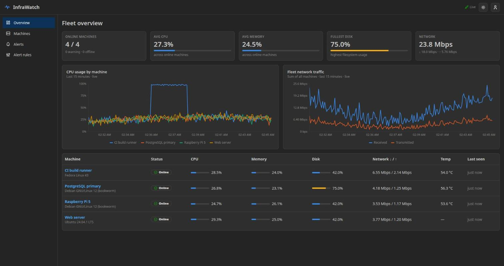
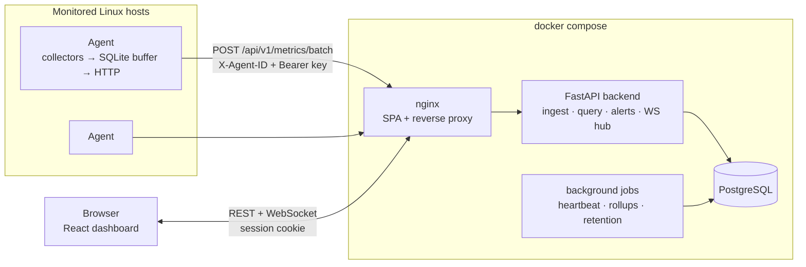
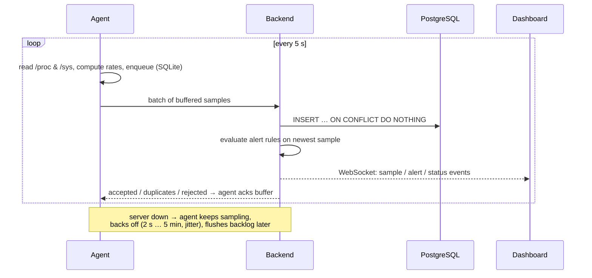
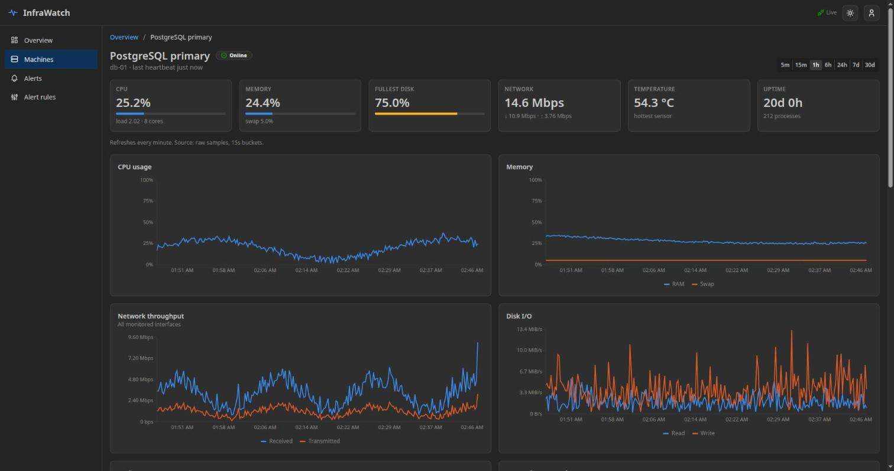
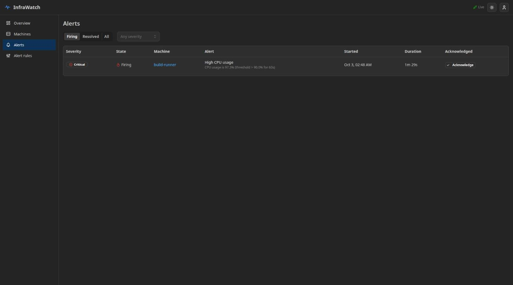

# InfraWatch

**Personal infrastructure monitoring platform**: a lightweight Linux agent, a FastAPI backend with
PostgreSQL time-series storage, rule-based alerting, and a real-time React dashboard.



InfraWatch is an agent/server monitoring system, not a single-host dashboard. Agents on each machine read
the kernel's own interfaces (`/proc`, `/sys`), buffer samples durably, and deliver them at-least-once to the
server. The server validates, stores, downsamples, alerts on, and streams them to the browser over WebSockets.

---

## Contents

1. [Overview](#1-overview) · 2. [Architecture](#2-architecture) · 3. [Features](#3-features) ·
4. [Technology stack](#4-technology-stack) · 5. [Installation](#5-installation) · 6. [Docker setup](#6-docker-setup) ·
7. [Agent setup](#7-agent-setup) · 8. [systemd setup](#8-linux-systemd-setup) · 9. [Configuration](#9-configuration) ·
10. [API](#10-api-documentation) · 11. [Database](#11-database-architecture) · 12. [Security](#12-security-model) ·
13. [Screenshots](#13-screenshots) · 14. [Example usage](#14-example-usage) · 15. [Testing](#15-testing) ·
16. [Troubleshooting](#16-troubleshooting) · 17. [Future improvements](#17-future-improvements)

---

## 1. Overview

| | |
|---|---|
| **Agent** | Python ≥ 3.10, two dependencies (`psutil`, `httpx`). Collects CPU, memory, disk, network, TCP states, temperatures, processes, and system info every 5 s. Uses ~40 MB RSS. Survives server outages with a SQLite-backed buffer. |
| **Backend** | FastAPI + SQLAlchemy 2 (async) + PostgreSQL. Authenticated ingestion, idempotent batch writes, a query planner over raw/hourly/daily tiers, an alert engine, heartbeat detection, and a WebSocket fan-out. |
| **Dashboard** | React 19 + TypeScript + Mantine + Recharts. Live fleet overview, per-machine history (5 min – 30 days), P95/P99 statistics, alerts, and machine/rule management. Dark and light mode. |
| **Deployment** | `docker compose up -d`: three containers, one public port. |

The goal was to make the *engineering* decisions explicit: each one, with the alternatives considered, is in
**[docs/architecture.md](docs/architecture.md)**.

## 2. Architecture





Repository layout:

```text
personal-infrastructure-monitor/
├── agent/                     # Linux monitoring agent (pip-installable)
│   ├── infrawatch_agent/
│   │   ├── collectors/        # cpu, memory, disk, network, sensors, processes, host
│   │   ├── transport/         # SQLite buffer, backoff, HTTP client
│   │   ├── config/            # env + env-file configuration
│   │   ├── security/          # secret redaction, permission checks
│   │   ├── main.py            # run loop
│   │   └── cli.py             # start | status | test | config
│   └── tests/
├── backend/
│   ├── app/
│   │   ├── api/               # REST routers
│   │   ├── auth/              # passwords, tokens, rate limiting, dependencies
│   │   ├── database/          # engine/session, declarative base
│   │   ├── models/            # SQLAlchemy ORM models
│   │   ├── schemas/           # Pydantic models (incl. agent wire protocol)
│   │   ├── services/          # ingestion, history, alerts, retention, heartbeat
│   │   ├── websocket/         # pub/sub hub + endpoint
│   │   └── main.py            # app factory, lifespan, background jobs
│   ├── migrations/            # Alembic
│   └── tests/                 # integration tests against real PostgreSQL
├── frontend/src/              # components, pages, hooks, services, types, charts
├── docker/                    # Dockerfiles
├── docs/                      # architecture, protocol, retention, security
├── scripts/                   # systemd unit, installer, fleet simulator
├── docker-compose.yml
└── Makefile
```

## 3. Features

**Collection (agent)**
- CPU: total, per-core, iowait, steal, frequency, load average, context switches, and interrupts per second (from `/proc/stat` jiffy deltas)
- Memory: total/used/available/cached/buffers and swap (`/proc/meminfo`; "used" excludes reclaimable cache)
- Disk: per-filesystem capacity (deduplicated btrfs subvolumes and bind mounts); per physical disk read/write bytes/s, IOPS, and busy % (`/proc/diskstats`)
- Network: per interface RX/TX bytes and packets per second, errors, drops, link state, speed, MTU, and addresses (`/proc/net/dev`, `/sys/class/net`); TCP socket counts by state (`/proc/net/tcp{,6}`)
- Temperatures: CPU/GPU/NVMe/disk/Wi-Fi sensors from `hwmon`, with a thermal-zone fallback; missing sensors just mean an empty list
- Processes: top N by CPU and memory with user, state, threads, and command line (credentials redacted)
- System: hostname, OS, kernel, architecture, CPU model, cores, RAM, boot time, uptime
- Self-monitoring: the agent's own CPU, RSS, collection time, queue length, failed uploads, and dropped samples

**Reliability**
- Durable SQLite buffer (bounded, drops oldest), exponential backoff with jitter, and `Retry-After` support
- Failures classified as retry / auth / poison / too-large, so one bad batch can't block the queue
- Idempotent ingestion: re-sent samples are de-duplicated by `(agent, timestamp)`
- Each collector is fault-isolated; permission errors and vanished processes are handled per item

**Server**
- Per-agent API keys, validated payloads (bounded sizes, ranges, timezone-aware timestamps)
- History for any window (`range=1h` or `start`/`end`), auto-downsampled to ~300 points
- Exact avg/min/max/P50/P95/P99 within raw retention
- Three-tier retention: raw → hourly → daily, recomputed idempotently
- Rule-based alerts (metric, operator, threshold, sustained duration, severity, fleet-wide or per machine), offline detection, acknowledgement, auto-resolve
- Online / warning / offline / pending machine health from heartbeats (server clock, with a restart grace period)
- WebSocket push of samples, status changes, and alerts, with backpressure handling
- Users with Argon2id passwords, server-side sessions, admin/viewer roles, and an audit log

**Dashboard**
- Fleet overview with live CPU-per-machine and network charts
- Machine page: live tiles, 8 history charts, statistics table, processes, interfaces, storage, per-core CPU, sensors, system info, alerts
- Time ranges: 5m · 15m · 1h · 6h · 24h · 7d · 30d
- Alert list with filters and acknowledgement; toast notifications on new alerts
- Machine registration showing the API key once, key rotation, deletion; alert rule editor
- Accessible: status shown with icon + text, colour-vision-safe palette, dark/light mode, keyboard-navigable components

## 4. Technology stack

| Layer | Choice | Why |
|-------|--------|-----|
| Agent | Python 3.10+, **psutil**, **httpx** | psutil for the process table and statvfs only (everything else is parsed from `/proc`/`/sys` directly). httpx for explicit connect/read timeouts and TLS verification. SQLite for the buffer (stdlib). |
| API | **FastAPI**, **Pydantic v2**, Uvicorn | Typed request validation and automatic OpenAPI docs; native async and WebSockets. |
| Persistence | **PostgreSQL 16**, **SQLAlchemy 2 (async) + asyncpg**, **Alembic** | JSONB, `date_bin`, `percentile_cont`, partial unique indexes, and `ON CONFLICT` do real work here. |
| Auth | **argon2-cffi** | Argon2id password hashing. Sessions and API keys are plain `secrets` + SHA-256 (no JWT library needed). |
| Frontend | **React 19 + TypeScript + Vite**, **Mantine**, **Recharts**, React Router | Mantine provides accessible components with built-in dark mode; Recharts for SVG time-series. Data fetching uses a 40-line hook instead of an extra library. |
| Ops | Docker / Compose, nginx (unprivileged), systemd | |
| Quality | pytest, Vitest + Testing Library, Ruff, mypy, ESLint, pre-commit, GitHub Actions | |

## 5. Installation

Requirements: Docker with Compose (or Podman + podman-compose) for the server; Python ≥ 3.10 on monitored
hosts. For development: Python 3.12+, Node 22+.

```bash
git clone https://github.com/kaganksgl/personal-infrastructure-monitor.git
cd personal-infrastructure-monitor
make install          # .venv with backend + agent (dev extras), and frontend node_modules
```

## 6. Docker setup

```bash
cp .env.example .env
sed -i "s/^POSTGRES_PASSWORD=$/POSTGRES_PASSWORD=$(openssl rand -hex 24)/" .env
docker compose up -d
```

Open **http://localhost:8080**. The first account you register becomes the administrator. Interactive API
docs are at **http://localhost:8080/api/docs**.

| Container | Image | Exposed |
|-----------|-------|---------|
| `frontend` | nginx-unprivileged, serves the SPA, proxies `/api` + WebSocket | `${HTTP_PORT:-8080}` |
| `backend` | python:3.12-slim, non-root; runs `alembic upgrade head` then Uvicorn | internal only |
| `postgres` | postgres:16-alpine with a named volume | internal only |

For anything beyond `localhost`, put a TLS-terminating proxy (Caddy, Traefik, nginx + Let's Encrypt) in
front: session cookies are `Secure`, and agents should use `https://`.

With Podman: `make up COMPOSE=podman-compose`.

## 7. Agent setup

1. In the dashboard: **Machines → Add machine**. Pick an agent ID (e.g. the hostname). The API key is shown
   **once**.
2. On the machine:

```bash
python3 -m venv ~/.local/infrawatch && ~/.local/infrawatch/bin/pip install ./agent
cat > ~/.config/infrawatch.env <<'CONF'
SERVER_URL=https://monitor.example.com
AGENT_ID=web-01
API_KEY=iwk_...
CONF
chmod 600 ~/.config/infrawatch.env

infrawatch-agent --config ~/.config/infrawatch.env test     # collectors + connectivity + credentials
infrawatch-agent --config ~/.config/infrawatch.env start    # foreground
```

`python -m infrawatch_agent` is equivalent to `infrawatch-agent start`.

```text
$ infrawatch-agent test          # real output, hostname shortened
Collectors
  cpu        ok           3.0 ms
  memory     ok           0.2 ms
  disks      ok           1.9 ms
  network    ok           7.7 ms
  sensors    ok          32.6 ms
  processes  ok          61.2 ms
  host       ok           0.2 ms

Summary
  Host          workstation (Fedora Linux 43 (KDE Plasma Desktop Edition), kernel 7.2.6-100.fc43.x86_64)
  CPU           Intel(R) Core(TM) Ultra 7 255H: 6.68%
  Load average  0.79 1.67 2.11
  Memory        7.3 / 30.3 GiB (24.0%)
  Filesystems   3
  Interfaces    enp0s31f6, wlp0s20f3
  Sensors       24, hottest 50.0°C
  Processes     484

Server
  https://monitor.example.com: reachable
  credentials for 'web-01': valid
```

| Command | Purpose |
|---------|---------|
| `infrawatch-agent start [--once]` | Run the collection loop (or one cycle, exit code 0 if delivered) |
| `infrawatch-agent status [--json]` | Inspect a running agent: last collection/upload, buffer size, failures, next retry |
| `infrawatch-agent test [--json]` | Run each collector with timings, print or dump the payload, check server and credentials |
| `infrawatch-agent config` | Show effective configuration and its source (API key masked) and security warnings |
| `infrawatch-agent --version` | Version |

No root privileges are needed. As a normal user, processes owned by other users show no command line, which
the agent handles.

## 8. Linux systemd setup

The installer creates a dedicated system user, a virtualenv in `/opt/infrawatch-agent`, a config file at
`/etc/infrawatch/agent.env` (`root:infrawatch 0640`), runs `test`, and enables the service:

```bash
sudo ./scripts/install-agent.sh --server https://monitor.example.com --agent-id web-01 --api-key iwk_...
systemctl status infrawatch-agent
journalctl -u infrawatch-agent -f          # structured JSON logs
```

The [unit file](scripts/infrawatch-agent.service) runs unprivileged with `ProtectSystem=strict`, no
capabilities, `MemoryDenyWriteExecute`, `CPUQuota=10%`, and `MemoryMax=128M`. Its buffer lives in
`StateDirectory=/var/lib/infrawatch`.

## 9. Configuration

**Server** (`.env`, see [.env.example](.env.example)):

| Variable | Default | Description |
|----------|---------|-------------|
| `POSTGRES_PASSWORD` | (required) | Database password; Compose refuses to start without it |
| `HTTP_PORT` / `HTTP_BIND` | `8080` / `0.0.0.0` | Published dashboard/API port |
| `COOKIE_SECURE` | `true` | Send session cookies only over HTTPS (localhost counts as secure) |
| `ALLOW_REGISTRATION` | `false` | Allow self-registration (as viewer) after the first admin exists |
| `SESSION_TTL_HOURS` | `12` | Session lifetime |
| `AGENT_OFFLINE_AFTER_SECONDS` | `30` | Heartbeat timeout |
| `RAW_RETENTION_HOURS` | `48` | Raw sample retention |
| `METRIC_RETENTION_DAYS` | `30` | Hourly rollup retention |
| `DAILY_RETENTION_DAYS` | `365` | Daily rollup retention |
| `CORS_ORIGINS` | (empty) | Comma-separated origins, only if the UI is served elsewhere |
| `LOG_LEVEL` | `INFO` | Log level |

Also: `INGEST_RATE_PER_MINUTE` (120), `LOGIN_RATE_PER_MINUTE` (10), `MAX_BATCH_SIZE` (100),
`MAX_CLOCK_SKEW_SECONDS` (300), `RETENTION_JOB_INTERVAL_SECONDS` (300).

**Agent** (environment variables or an env-file via `--config`, `$INFRAWATCH_CONFIG`, or
`/etc/infrawatch/agent.env`; environment wins over the file):

| Variable | Default | Description |
|----------|---------|-------------|
| `SERVER_URL` | `http://localhost:8080` | Backend base URL |
| `AGENT_ID` | hostname | Must match the registered machine |
| `API_KEY` | (required) | Issued by the dashboard |
| `COLLECTION_INTERVAL` | `5` | Seconds between samples |
| `BUFFER_SIZE` | `1000` | Max buffered samples during outages (≈ 83 min at 5 s) |
| `BUFFER_PATH` / `STATE_PATH` | `$XDG_STATE_HOME/infrawatch/…` | Buffer DB and status file |
| `BATCH_SIZE` | `50` | Samples per upload request |
| `MAX_BACKOFF` | `300` | Upper bound for retry delay (s) |
| `REQUEST_TIMEOUT` | `10` | HTTP timeout (s) |
| `VERIFY_TLS` / `CA_BUNDLE` | `true` / (empty) | TLS verification, custom CA |
| `TOP_PROCESSES` | `10` | Processes per top list |
| `COLLECT_CMDLINE` | `true` | Send (redacted) process command lines |
| `NET_EXCLUDE` | `lo`, `veth*`, `docker*`, … | Regex of interfaces to skip |
| `LOG_LEVEL` / `LOG_FORMAT` | `INFO` / `json` | `json` for journald/Loki, `text` for humans |

## 10. API documentation

OpenAPI/Swagger UI: `/api/docs` · ReDoc: `/api/redoc` · schema: `/api/openapi.json`.

| Method | Path | Auth | Description |
|--------|------|------|-------------|
| `GET` | `/api/v1/auth/status` | – | Whether registration is open |
| `POST` | `/api/v1/auth/register` · `/login` · `/logout` | – / – / user | Account and session lifecycle |
| `GET` | `/api/v1/auth/me` | user | Current user |
| `GET` | `/api/v1/agents` | user | Fleet with status and latest metrics |
| `POST` | `/api/v1/agents` | admin | Register a machine and return its API key once |
| `GET` / `DELETE` | `/api/v1/agents/{id}` | user / admin | Machine detail / delete (cascades data) |
| `POST` | `/api/v1/agents/{id}/rotate-key` | admin | Issue a new key (old one stops working) |
| `POST` | `/api/v1/metrics` · `/metrics/batch` | agent key | Ingest one sample / a batch |
| `GET` | `/api/v1/agent/ping` | agent key | Verify agent credentials |
| `GET` | `/api/v1/metrics/{id}?range=1h&metrics=cpu_percent,net_rx_bps` | user | Downsampled time series (`start`/`end` also accepted) |
| `GET` | `/api/v1/metrics/{id}/stats?range=24h` | user | avg/min/max/P50/P95/P99 |
| `GET` | `/api/v1/metrics/{id}/latest` | user | Newest full sample (processes, interfaces, …) |
| `GET` | `/api/v1/metrics/catalog` | user | Available metric names, labels, units |
| `GET` | `/api/v1/alerts?status=firing&severity=critical` | user | Alerts |
| `POST` | `/api/v1/alerts/{id}/acknowledge` | user | Acknowledge |
| `GET` / `POST` / `PATCH` / `DELETE` | `/api/v1/alerts/rules[/{id}]` | user / admin | Alert rules |
| `GET` | `/api/v1/system/health` | – | Liveness/readiness (DB check) |
| `GET` | `/api/v1/system/audit` | admin | Audit log |
| `WS` | `/api/v1/ws` | user | Live events: `sample`, `agent_status`, `alert`, `agents_changed`, `resync` |

The agent wire format is specified in **[docs/agent-protocol.md](docs/agent-protocol.md)**.

## 11. Database architecture

```mermaid
erDiagram
    users ||--o{ user_sessions : has
    users ||--o{ audit_logs : performs
    users ||--o{ agents : registers
    agents ||--o{ metric_samples : reports
    agents ||--o{ metric_rollups : "aggregated into"
    agents ||--o{ alerts : raises
    agents ||--o{ alert_rules : "scoped rules"
    alert_rules ||--o{ alerts : fires

    agents { int id PK
             string agent_id UK
             string api_key_hash
             jsonb system_info
             bool is_online
             timestamptz last_seen_at }
    metric_samples { int agent_pk PK
                     timestamptz ts PK
                     float cpu_percent
                     float memory_percent
                     float net_rx_bps
                     float "... 17 scalar metrics"
                     jsonb details }
    metric_rollups { int agent_pk PK
                     string resolution PK
                     string metric PK
                     timestamptz bucket_start PK
                     float avg
                     float min
                     float max
                     int sample_count }
    alerts { int id PK
             string severity
             string status
             timestamptz started_at
             timestamptz acknowledged_at }
```

**Why not one table per metric type?** A sample is written and read as a unit. Scalar metrics that are
charted, aggregated, and alerted on get **typed columns** (range scans with no JSON parsing). Variable-length
detail (per-core, per-interface, per-disk, sensors, processes) goes in **JSONB**. Splitting into
`cpu_metrics`, `network_metrics`, … would mean 5–6 joins per dashboard query and one row per interface per
sample. Rollups use a **long format** (one row per metric per bucket), so new metrics need no migration.

Other decisions:
- `(agent_pk, ts)` is the primary key: it serves as the time-range index and gives idempotent ingestion
- A partial unique index guarantees one *firing* alert per (agent, rule), even under concurrent requests
- Enums are `CHECK`-constrained strings (easier to evolve than PostgreSQL enum types)
- All queries go through the SQLAlchemy ORM/Core with bound parameters

Data retention and downsampling are described in **[docs/retention.md](docs/retention.md)**.

## 12. Security model

Summary (details and a threat table in **[docs/security.md](docs/security.md)**):

- **Agents:** per-agent random API keys; only the SHA-256 is stored; constant-time comparison; identical
  errors for unknown agent and wrong key; the payload's `agent_id` must match the key.
- **Users:** Argon2id passwords; opaque server-side sessions in `HttpOnly; Secure; SameSite=Strict`
  cookies; real logout; admin/viewer roles; the first user becomes admin (race-free).
- **Web:** CSRF header requirement, WebSocket Origin check, strict CSP and frame-denial headers, CORS off by
  default.
- **Abuse:** rate limits on login, registration, and ingestion; request size caps; bounded schemas.
- **Secrets:** none in the repo; Compose requires `POSTGRES_PASSWORD`; logs mask secret-like fields; the
  agent redacts credentials in process command lines and warns about world-readable configs and
  plain-HTTP remote servers.
- **Isolation:** only nginx is exposed; containers and the agent run as non-root; systemd sandboxing.
- **Accountability:** audit log for logins (including failures), agent and rule changes, and
  acknowledgements.

## 13. Screenshots

| Fleet overview (dark) | Machine detail |
|---|---|
|  |  |

| Alerts |
|---|
|  |

Screenshots show the simulated fleet from `scripts/demo_fleet.py`.

## 14. Example usage

**Try it with a simulated fleet** (4 machines, 2 h of history; one host periodically pins its CPU so alerts
fire):

```bash
docker compose up -d
# register the first (admin) user in the UI, then:
INFRAWATCH_USER=admin INFRAWATCH_PASSWORD='…' make demo
```

**Query history from the API** ("CPU of machine X between 10:00 and 12:00"):

```bash
curl -s -b cookies.txt "http://localhost:8080/api/v1/metrics/web-01/stats?\
start=2026-10-03T10:00:00Z&end=2026-10-03T12:00:00Z&metrics=cpu_percent" | jq
```

```jsonc
// illustrative values
{
  "agent_id": "web-01", "source": "raw", "percentiles_exact": true,
  "stats": [{ "metric": "cpu_percent", "samples": 1440, "avg": 32.4,
              "min": 2.1, "max": 94.1, "p50": 28.0, "p95": 71.3, "p99": 88.9 }]
}
```

**Outage drill** (what the end-to-end test did): stop the backend while an agent runs. `infrawatch-agent
status` shows the buffer growing and the next retry time. Restart the backend and the backlog is uploaded in
order. In the test run, 75/75 samples arrived, with a largest gap of 2.09 s at a 2 s interval.

## 15. Testing

```bash
make test          # starts a throwaway PostgreSQL container, then runs every suite
make lint typecheck
```

| Suite | Count | What it covers |
|-------|-------|----------------|
| Backend (`pytest`, real PostgreSQL) | 53 | Registration/login/logout/session revocation, Argon2 storage, CSRF, rate limiting, roles; agent registration and key rotation; ingestion auth, cross-agent spoofing, malformed payloads, idempotency, timestamp windows, batch limits; history, exact percentiles, gaps, query planner; rollups, idempotent re-runs, purge; sustained-threshold alerts, resolve, acknowledge, offline detection and grace period; WebSocket push, auth and Origin check; hub backpressure |
| Agent (`pytest`) | 48 | Each collector against a fake `/proc`/`/sys` tree (jiffy math, counter resets, physical-disk filtering, hwmon classification, missing sensors, vanishing processes); buffer durability; backoff; HTTP outcome classification; outage → buffer → flush ordering; poison and auth handling; 413 batch halving; config precedence; secret redaction; **contract test validating a real sample against the backend schema** |
| Frontend (Vitest + Testing Library) | 21 | Formatters, chart data transforms, accessible badges, API client (CSRF header, 401 handling), WebSocket store (reconnect, resync, 4401), login flow |

Backend tests run against a real PostgreSQL on purpose: JSONB, `date_bin`, `percentile_cont`, partial
indexes, and `ON CONFLICT` are part of what's being tested. Set `TEST_DATABASE_URL` to use another
database. CI (`.github/workflows/ci.yml`) runs all suites, the agent on Python 3.10 and 3.12, and the Docker
build.

## 16. Troubleshooting

| Symptom | Cause / fix |
|---------|-------------|
| `docker compose up` says `Set POSTGRES_PASSWORD in .env` | Copy `.env.example` to `.env` and set a password. |
| Login works but you're immediately logged out | You're using plain HTTP on a non-localhost address. Use HTTPS, or (not recommended) `COOKIE_SECURE=false`. |
| Dashboard shows **Disconnected** | WebSocket blocked. If you added your own proxy, forward `Upgrade`/`Connection` headers and keep the original `Host` (including port). |
| Agent `test`: `credentials … REJECTED` | Wrong `AGENT_ID`/`API_KEY` pair, or the key was rotated. Rotate the key in the dashboard and update the config. |
| Agent logs `upload.failed outcome=retry` | Server unreachable. Data is buffered; check `infrawatch-agent status` for buffer size and next retry. |
| Agent logs `upload.sample_rejected … future` | The machine's clock is off by more than 5 min. Enable NTP (`timedatectl set-ntp true`). |
| Machine stays **Pending** | The agent never reported. Run `infrawatch-agent test` on it. |
| No temperatures | The host exposes no `hwmon`/thermal sensors (common in VMs). This is expected; temperature alerts never fire there. |
| Network rates look doubled | Traffic counted on both a bridge and its members. Extend `NET_EXCLUDE`. |
| `make test` can't reach PostgreSQL | Port 5433 is in use or no container runtime is available. Set `CONTAINER=podman`, or point `TEST_DATABASE_URL` at your own database. |

## 17. Future improvements

The design leaves seams for these (see [architecture.md § Extension points](docs/architecture.md#extension-points)):

- Rust agent (same protocol) for a smaller footprint; Windows/macOS agents
- Email, Discord, and Telegram notifiers (implement `AlertNotifier`)
- Prometheus `/metrics` exporter and a Grafana data source
- Docker container, GPU (NVML), and Kubernetes node metrics as new collectors
- Per-interface and per-disk history tables
- Mutual-TLS agent authentication; finer-grained RBAC; 2FA
- Horizontal scaling: PostgreSQL `LISTEN/NOTIFY` or Redis for the WebSocket hub and rate limits; TimescaleDB hypertables
- Anomaly detection on rollups (seasonal baselines instead of static thresholds)
- Agent auto-update with signed releases

## License

[MIT](LICENSE)
