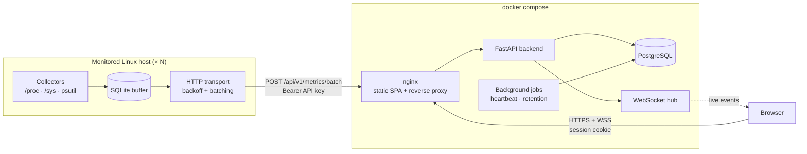
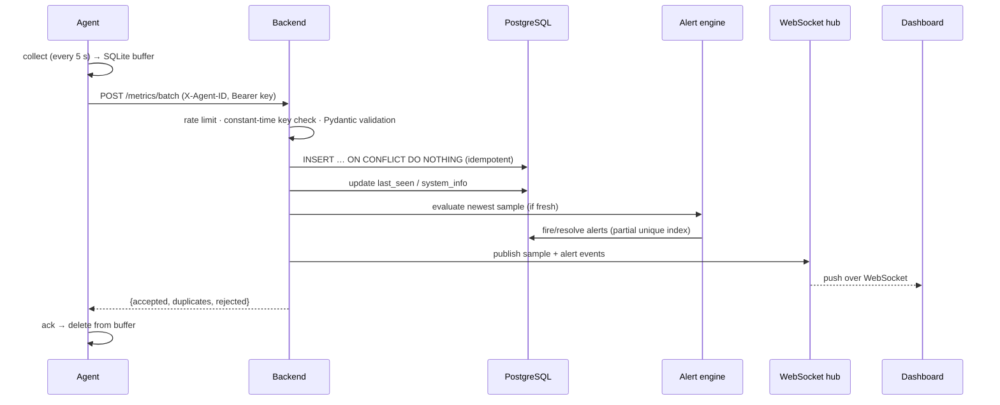

# Architecture and design decisions

This document explains *why* InfraWatch is built the way it is. Each decision
lists the alternative that was considered and the trade-off accepted.

## Components

| Component | Responsibility |
|-----------|----------------|
| **Agent** (`agent/`) | Collect metrics, buffer them durably, deliver at-least-once. Stateless with respect to the server. |
| **Backend** (`backend/`) | Authenticate, validate, store, aggregate, evaluate alerts, push live events, serve history. |
| **Dashboard** (`frontend/`) | Visualise live + historical data; manage machines and alert rules. |
| **nginx** | Single public origin: serves the SPA, proxies `/api` and the WebSocket, adds security headers. |

## Request lifecycle of one sample

## Key decisions

### 1. Hybrid storage: typed columns + JSONB

`metric_samples` has one row per sample with **typed columns** for the 17
scalar metrics that are charted, aggregated and alerted on
(`cpu_percent`, `net_rx_bps`, …) and a **JSONB `details`** column for
variable-cardinality data (per-core, per-interface, per-disk, sensors,
process lists).

*Alternative:* one table per metric family (`cpu_metrics`,
`network_metrics`, …). Rejected because every dashboard query would join 5–6
tables on `(agent, ts)`, per-interface tables need a row per interface per
sample (a 10× row explosion), and new interface fields would need migrations.

*Trade-off:* per-interface history is not directly queryable in SQL (only the
aggregated totals are). The newest sample's detail is served from JSONB for
the detail tables; per-interface history would be the first thing to promote
into its own table if needed.

### 2. Composite primary key `(agent_pk, ts)`

The primary key is also the time-range index, so `WHERE agent_pk = ? AND ts
BETWEEN ? AND ?` is an index range scan, and "newest sample" is a backwards
index scan with `LIMIT 1`. It also makes **ingestion idempotent**: an agent
that re-sends a batch because the HTTP response was lost gets
`duplicates: N` instead of duplicate rows. This is what allows
at-least-once delivery from the agent to be safe.

### 3. Long-format rollups

`metric_rollups(agent, resolution, metric, bucket_start, avg, min, max,
sample_count)` stores one row per metric per bucket instead of ~50
`cpu_avg/cpu_min/…` columns. New metrics need no migration, the rollup job is
generic over the metric catalog, and volume stays small (≈12k rows per agent
for 30 days of hourly data). `sample_count` makes re-aggregation exact:
daily averages are **weighted** by the number of underlying samples.

### 4. Agent computes rates

Network/disk counters are cumulative. The agent turns them into per-second
rates because it knows the exact interval between its own readings and can
detect counter resets (interface re-created, 32-bit wrap). This keeps the
backend stateless per agent. The raw counters are sent too, so nothing is
lost. The rule is part of the [wire protocol](agent-protocol.md), which a
future Rust agent must follow.

### 5. Collection decoupled from delivery

The agent's loop *always* collects into a SQLite-backed queue and then tries
to upload. When the server is down, only uploads back off (exponential, with
jitter, capped); sampling continues. Upload outcomes are classified:

| Outcome | Example | Action |
|---------|---------|--------|
| retry | timeout, connection refused, 5xx, 429 | keep data, back off |
| auth | 401/403 | keep data, back off to the cap, log loudly |
| rejected | 400/422 | drop the batch: a "poison message" must not block the queue |
| too large | 413 | halve the batch size and retry immediately |

SQLite (from the standard library) was chosen over an in-memory deque so a
crash or reboot during an outage does not lose the backlog.

### 6. Sessions instead of JWTs for the dashboard

Dashboard users get an opaque 256-bit token in an `HttpOnly; Secure;
SameSite=Strict` cookie; only its SHA-256 is stored server-side.

*Alternative:* JWT in `localStorage`. Rejected: any XSS could steal it, and
JWTs cannot be revoked before expiry without a server-side denylist, which
recreates sessions anyway. With server-side sessions **logout is real** and an
admin could revoke sessions.

### 7. Hash choice: Argon2id for passwords, SHA-256 for tokens

Passwords are low-entropy and need a slow, memory-hard hash (Argon2id).
API keys and session tokens are 256-bit random values; brute-forcing a
SHA-256 preimage of those is infeasible, and a fast hash keeps per-request
authentication cheap (every agent request is authenticated).

### 8. Server clock for heartbeats

`last_seen_at` is set from the **server** clock on every request, never from
the sample timestamp, so a machine with a wrong clock cannot appear
online/offline incorrectly. Sample timestamps (agent clock) are used for the
data itself; timestamps more than 5 min in the future are rejected.

After a backend restart, all agents look stale. A **grace period** of one
offline window prevents a server restart from paging for the whole fleet.
This was found during an end-to-end outage test.

### 9. Alert evaluation on ingest

Rules are evaluated against the newest sample of each batch. Only *fresh*
samples are evaluated: a backlog uploaded after an outage is history and must
not fire stale alerts. Sustained conditions ("> 90 % for 60 s") are measured
on sample timestamps. A partial unique index
`(agent_pk, rule_id) WHERE status = 'firing'` guarantees a single firing
alert per rule, even with concurrent requests (`INSERT … ON CONFLICT DO
NOTHING`).

*Trade-off:* the "pending since" state of not-yet-fired rules is held in
memory, so after a restart a sustained condition needs one more full duration
to fire. Persisting it would add a write per sample per rule for little gain.

### 10. One process, in-process pub/sub

The WebSocket hub, rate limiters and alert pending state are in-process. This
is the right size for a personal fleet and keeps deployment to three
containers. Every one of them is behind a small interface (`Hub.publish`,
`RateLimiter.hit`, `AlertNotifier`), so scaling out means swapping in
PostgreSQL `LISTEN/NOTIFY` or Redis without touching endpoints.

### 11. Single origin via nginx

Serving the SPA and the API from the same origin means no CORS in production,
and `SameSite=Strict` cookies work for both REST and WebSocket. The Vite dev
server proxies `/api` the same way, so development behaves like production.

## Extension points

| Future feature | Where it plugs in |
|----------------|-------------------|
| Rust / Windows / macOS agent | Implement [agent-protocol.md](agent-protocol.md); no backend change. |
| Email / Discord / Telegram alerts | New class implementing `AlertNotifier` (`services/alerts/notifier.py`). |
| Prometheus exporter | New router reading `metric_samples` latest rows; metric names already centralised in `metrics_catalog.py`. |
| Docker / GPU / Kubernetes metrics | New agent collector + optional new protocol section (unknown fields are ignored by older servers). |
| Multiple backend replicas | Replace `Hub` with LISTEN/NOTIFY, `RateLimiter` with Redis. |
| mTLS agent auth | `authenticated_agent` dependency is the single place agents are authenticated. |
| RBAC | `users.role` already exists with a CHECK constraint; `require_admin` shows the pattern. |
| Anomaly detection | A notifier-like consumer of `IngestionPipeline` output, or a job over rollups. |
