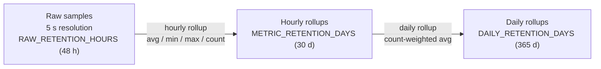

# Data retention and downsampling

At a 5-second interval, one machine produces 17,280 samples per day. Keeping
all of them forever is neither useful nor cheap, so InfraWatch stores data in
three tiers:

| Tier | Table | Kept for | Used for ranges |
|------|-------|----------|-----------------|
| Raw | `metric_samples` | `RAW_RETENTION_HOURS` (48) | 5 m – 24 h |
| Hourly | `metric_rollups` (`resolution='1h'`) | `METRIC_RETENTION_DAYS` (30) | 7 d, 30 d |
| Daily | `metric_rollups` (`resolution='1d'`) | `DAILY_RETENTION_DAYS` (365) | > 30 d |

## The retention job

Runs every `RETENTION_JOB_INTERVAL_SECONDS` (5 min) inside the backend:

1. **Hourly rollup** of the last 6 hours of raw samples (including the
   current, partial hour) using `date_trunc('hour', ts, 'UTC')`. Results are
   **upserted**, so recomputing is harmless, and samples that arrive late
   (an agent uploading its backlog after an outage) land in the right bucket.
2. **Daily rollup** of the last 2 days of hourly rows. Averages are
   weighted by `sample_count`, so a day with a 2-hour outage is not skewed.
3. **Commit**, and only then
4. **Purge** raw samples, rollups, resolved alerts and expired sessions past
   their retention.

Committing the rollups before deleting raw data means a crash between steps can
never lose data that was not yet aggregated.

## Query planning

`GET /api/v1/metrics/{agent}?range=…` picks the source automatically and
re-buckets with PostgreSQL's `date_bin()` so every chart has about 300 points:

| Range | Source | Bucket |
|-------|--------|--------|
| 5m | raw | 5 s |
| 15m | raw | 5 s |
| 1h | raw | 15 s |
| 6h | raw | 1 min |
| 24h | raw | 5 min |
| 7d | hourly | 1 h |
| 30d | hourly | 3 h |

Missing buckets (machine offline) become explicit `null` points, so charts
show a gap instead of a misleading straight line.

## Statistics and percentiles

`/stats` returns avg / min / max / P50 / P95 / P99. Within raw retention
these are **exact** (`percentile_cont` over raw samples). Avg/min/max remain
exact over rollups (weighted average, min of mins, max of maxes), but
percentiles cannot be reconstructed from pre-aggregated data. For older
ranges the API returns `null` percentiles and `"percentiles_exact": false`
rather than an invented number.

## Storage estimate

Measured on a real 16-core desktop (24 sensors, 2 interfaces, 2 × 10 top
processes): about **5 KB per raw sample** including indexes, almost all of it
the TOAST-compressed JSONB detail. Per machine at a 5 s interval:

* raw tier: 48 h × 720 samples/h ≈ 35k rows ≈ 175 MB
* hourly tier: 30 d × 24 × 17 metrics ≈ 12k rows ≈ 1.5 MB
* daily tier: 365 × 17 ≈ 6k rows ≈ 0.7 MB

The raw tier dominates. Lower `RAW_RETENTION_HOURS` or increase the
collection interval to trade resolution for disk.
