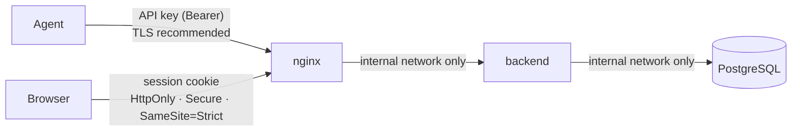

# Security model

InfraWatch is a networked application that accepts data from remote machines
and exposes system information to users, so it is treated as one. This page
lists the threats considered and the control for each.

## Trust boundaries

Only nginx publishes a port. PostgreSQL and the backend are reachable only on
the Compose-internal network.

## Controls

| Threat | Control | Where |
|--------|---------|-------|
| Arbitrary machines submitting metrics | Per-agent API key; `agent_id` in payload must match the key's agent | `auth/dependencies.py::authenticated_agent` |
| Stolen database dump reveals keys | Only SHA-256 of API keys / session tokens stored; passwords hashed with **Argon2id** | `auth/tokens.py`, `auth/passwords.py` |
| Timing attacks / agent ID enumeration | `hmac.compare_digest`; unknown agent and wrong key give identical 401; dummy Argon2 verify for unknown users | same |
| Online password guessing | Sliding-window rate limit per IP **and** per username on login; per-IP on registration | `auth/rate_limit.py`, `api/auth.py` |
| Agent flooding | Per-agent ingest rate limit, batch-size cap, 4 MiB body cap (app + nginx), bounded list/string sizes in every schema | `api/metrics.py`, `schemas/metrics.py`, `main.py` |
| Malformed / hostile payloads | Strict Pydantic types and ranges (e.g. 0 ≤ CPU% ≤ 100, timezone-aware timestamps); unknown fields dropped, never stored | `schemas/` |
| SQL injection | SQLAlchemy ORM/Core with bound parameters only; metric names in dynamic queries are validated against a fixed catalog before being mapped to column objects | `services/history.py` |
| XSS stealing sessions | Session token in `HttpOnly` cookie (unreadable from JS); React escapes output; strict Content-Security-Policy (`script-src 'self'`) | `api/auth.py`, `nginx.conf` |
| CSRF | `SameSite=Strict` cookie **plus** a required `X-Requested-With` header on state-changing requests (cannot be sent cross-site without a CORS preflight, which is refused) | `auth/dependencies.py::require_csrf_header` |
| Cross-site WebSocket hijacking | WebSocket handshake checks `Origin` against the host / allowed origins, then requires a valid session | `websocket/endpoint.py` |
| Clickjacking | `X-Frame-Options: DENY`, `frame-ancestors 'none'` | `nginx.conf` |
| Privilege escalation | Roles `admin` / `viewer`; first user is admin (race-free via advisory lock); later self-registration disabled by default | `services/auth_service.py` |
| Session theft lifetime | 12 h server-side expiry; logout deletes the server record; expired sessions purged | `services/auth_service.py` |
| Spoofed client IPs in logs / limits | Uvicorn trusts `X-Forwarded-For` only from the proxy; backend port is not published | `docker/backend.Dockerfile` |
| Secrets in source control | No defaults for secrets; Compose refuses to start without `POSTGRES_PASSWORD`; `.env` git-ignored | `docker-compose.yml`, `.gitignore` |
| Secrets in logs | Log formatter masks fields named like password/token/key/secret; agent config `repr` hides the key; CLI masks it | `logging_config.py`, agent `logging_setup.py` |
| Leaking secrets from monitored hosts | Agent redacts `--password=…`, `TOKEN=…`, `scheme://user:pass@` in process command lines before sending; cmdline collection can be disabled (`COLLECT_CMDLINE=false`) | agent `security/redact.py` |
| Agent key readable by other local users | Installer writes `agent.env` as `root:infrawatch 0640`; the agent warns if it is world-readable | `scripts/install-agent.sh` |
| Key sent in cleartext | Agent warns when `SERVER_URL` is `http://` to a non-local host; TLS verification on by default (`CA_BUNDLE` for private CAs) | agent `cli.py` |
| Compromised agent process | Runs as an unprivileged user under systemd sandboxing (`ProtectSystem=strict`, no capabilities, `MemoryDenyWriteExecute`, resource caps) | `scripts/infrawatch-agent.service` |
| Container breakout impact | Backend and nginx images run as non-root users | `docker/*.Dockerfile` |
| Repudiation | Append-only audit log of logins (incl. failures), logouts, registrations, agent create/delete/key rotation, rule changes, alert acknowledgements | `services/audit.py`, `GET /api/v1/system/audit` |
| Information disclosure via health endpoint | Unauthenticated `/system/health` returns only up/down, version and uptime | `api/system.py` |

## TLS

InfraWatch does not terminate TLS itself. In production, put it behind a
TLS-terminating proxy (Caddy, Traefik, or nginx with Let's Encrypt) and point
agents at `https://…`. Session cookies are `Secure` by default, so the
dashboard only works over HTTPS or on `localhost`.

## Known limitations

* Rate limits are per backend process (fine for the single-replica design).
* API keys are bearer secrets; mutual TLS would be stronger and is the
  intended upgrade path (single authentication dependency to replace).
* There is no account lockout beyond rate limiting, and no 2FA.
